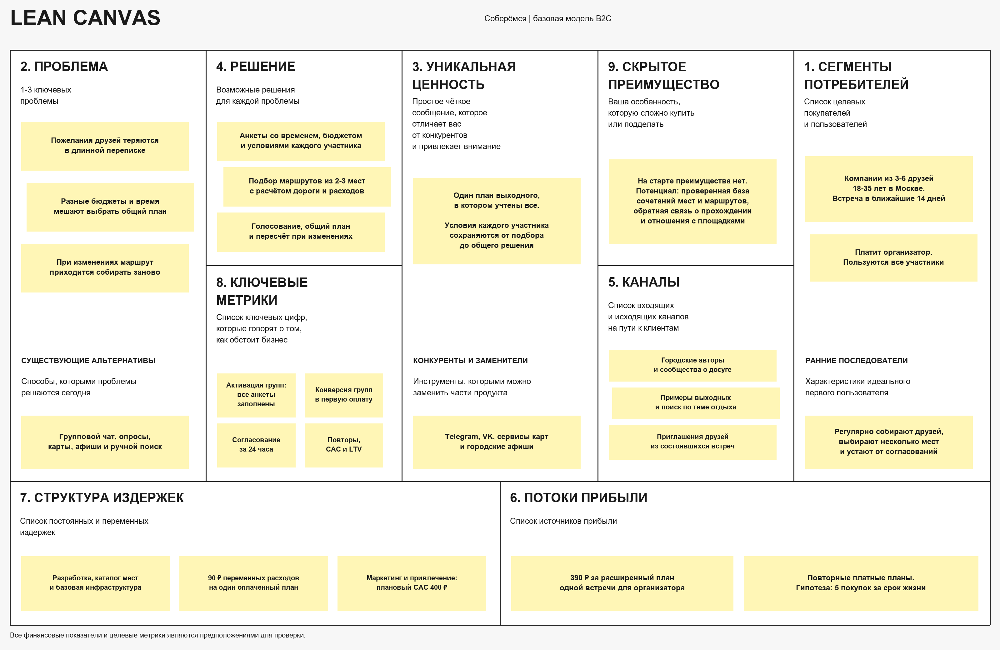
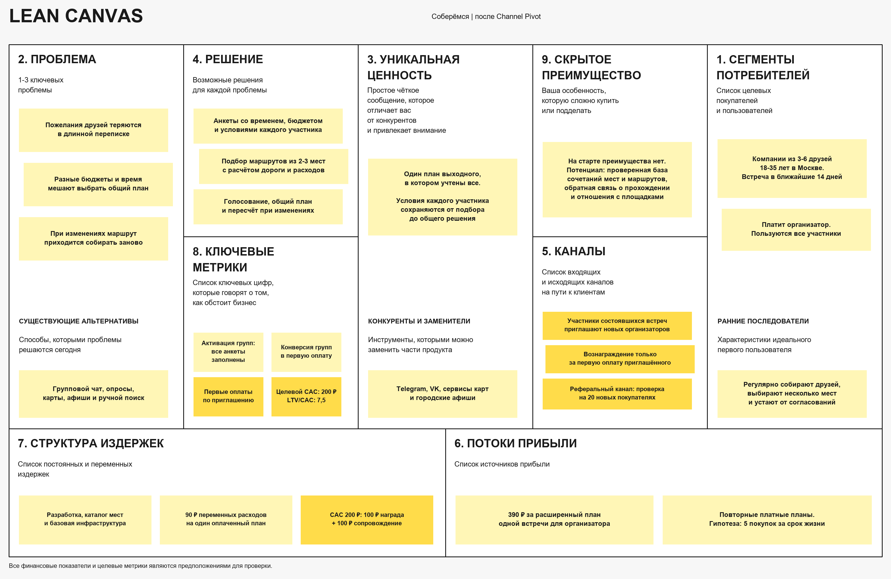
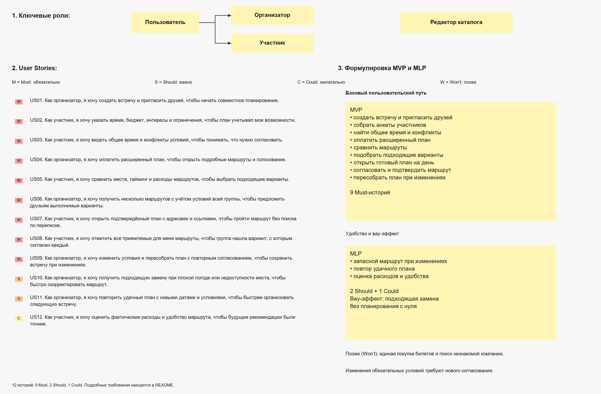

# Соберёмся — сервис для организации совместного досуга

**Бизнес-модель: B2C, оплата за план одной встречи.**

# Задание 1

## 1. Elevator Pitch

Собрать друзей на выходной часто сложнее, чем придумать сам отдых: у всех разное время, бюджет и интересы. Я предлагаю «Соберёмся» — сервис, который превращает пожелания компании в общий план. Участники заполняют короткую анкету, сервис предлагает маршруты из 2–3 мест с учётом дороги и расходов, а группа выбирает подходящий вариант. Главная особенность — соблюдение обязательных условий каждого: дорогой или неудобный маршрут не попадёт в рекомендации только потому, что нравится большинству. Организатор получает выполнимый план и меньше ручных согласований. Сбор пожеланий бесплатный, расширенный план одной встречи стоит 390 ₽ для организатора; друзья участвуют бесплатно. Собираетесь встретиться в ближайшие две недели? Попробуйте спланировать следующий выходной через наш пилот.

## 2. Lean Canvas

Первый сегмент — компании из 3–6 друзей 18–35 лет в Москве. В стоимость сервиса не входят билеты, питание и транспорт. Перед оплатой проверяется наличие минимум двух подходящих маршрутов и показывается обзор результата. Если вариантов недостаточно, оплата недоступна.

# Задание 2

## 1. HADI-гипотезы

### Гипотеза 1 — готовность платить, главная

* **H (гипотеза):** не менее 10 из 20 организаторов компаний из 3–6 друзей оплатят 390 ₽ за общий план выходного в течение 48 часов после предложения.
* **A (действие):** провести консьерж-пилот без разработки. Собрать пожелания друзей готовой онлайн-формой, вручную подобрать варианты с помощью карт и афиш, показать бесплатный обзор и предложить подробный план за 390 ₽. Оплатившим действительно предоставить маршруты и помощь в согласовании. Участники заранее знают, что подбор ручной.
* **D (данные):** число включённых групп, факт и время оплаты, причины отказа, затраты времени оператора и факт состоявшейся встречи. Считать только реальные оплаты без персональных скидок, а не обещания купить.
* **I (выводы):** 10–20 оплат — положительный сигнал для следующей проверки; 0–9 — гипотеза не поддержана в этом эксперименте. Разбираем, что помешало: цена, ценность результата, доверие или несовместимость условий.

В выборку входят первые 20 подходящих групп после заполнения анкет всеми участниками. Группы без общего времени или достаточного числа маршрутов остаются в знаменателе; оплату у них не принимаем. Долю групп, не завершивших анкеты, измеряем отдельно. При наборе менее 20 групп результат считается неполным.

### Гипотеза 2 — достижение общего решения

* **H (гипотеза):** не менее 14 из 20 групп согласуют маршрут в течение 24 часов после готовности последней анкеты.
* **A (действие):** на другой выборке из 20 групп бесплатно провести тот же ручной процесс: собрать условия, подготовить варианты и предложить каждому отметить все приемлемые маршруты. Так отказ платить не смешивается с оценкой удобства.
* **D (данные):** время готовности анкет, явное одобрение маршрута каждым участником и время окончательного подтверждения организатором. Время подбора оператором включается в 24 часа.
* **I (выводы):** 14–20 согласований — положительный сигнал; 0–13 — нужно пересмотреть подбор или механизм согласования. Молчание участника не считается согласием.

Оба эксперимента проверяют отдельные риски. Бесплатное использование не доказывает готовность платить, а успешный ручной сервис — удобство интерфейса и себестоимость будущего приложения.

## 2. Расчёт базовой юнит-экономики

### Воронка привлечения и CAC

Первые пользователи приходят из платных размещений у городских авторов и в сообществах о досуге. Дополнительный канал — участники встреч, которые позже станут организаторами собственных компаний.

* Бюджет размещений: **6 000 ₽**.
* Переходы: **600**. Предполагаемый CPC: 6 000 / 600 = **10 ₽**.
* Конверсия в создание встречи: **20%** → 120 встреч.
* Доля встреч с заполненными анкетами всех участников: **50%** → 60 встреч.
* Конверсия активированных групп в первую оплату: **50%** → 30 новых платящих организаторов.
* Подготовка материалов и работа с каналами: **4 500 ₽**.
* Инструменты привлечения: **1 500 ₽**.
* **CAC = (6 000 + 4 500 + 1 500) / 30 = 400 ₽.**

Юнит — новый платящий организатор. Приглашённый друг не считается новым платящим клиентом, а повторная покупка того же человека не увеличивает число привлечённых клиентов. Расходы и оплаты относятся к одной когорте.

### Расчёт LTV

* Цена расширенного плана: **390 ₽**.
* Переменные расходы на план: **90 ₽** — расчёты маршрутов и данные 35 ₽, инфраструктура 15 ₽, обработка оплаты 15 ₽, поддержка 25 ₽.
* Маржинальный вклад одного плана: **390 − 90 = 300 ₽**.
* Предполагаемое число платных планов за срок жизни организатора: **5** за условные 12 месяцев.

**LTV = 300 × 5 = 1 500 ₽.**

**LTV / CAC = 1 500 / 400 = 3,75.**

**Окупаемость привлечения = 400 / 300 ≈ 1,33 покупки**, то есть затраты покрываются после второй покупки.

### Вывод

При заданных предположениях отношение LTV/CAC выше ориентира 3:1. После привлечения остаётся 1 100 ₽ маржинального вклада на организатора, из которого ещё нужно покрыть постоянные расходы, налоги и разработку. Это не чистая прибыль и не доказанная экономика.

Если организатор покупает только два плана, LTV снижается до 600 ₽, а LTV/CAC — до 1,5. Если одновременно CAC вырастает до 800 ₽, отношение становится 0,75: привлечение не окупается. Фактические данные необходимо получить на пилоте и последующих когортах.

## 3. Pivot

Если пользователи платят и возвращаются, но CAC превышает **500 ₽**, можно провести **Channel Pivot**: заменить основной канал платных размещений рекомендациями участников состоявшихся встреч. Продукт и модель B2C сохраняются; меняется способ привлечения.

Предположение для нового канала: 100 ₽ вознаграждения за нового платящего организатора и ещё 100 ₽ на сопровождение и материалы. Тогда **CAC ≈ 200 ₽**, а при прежнем LTV 1 500 ₽ отношение **LTV/CAC ≈ 7,5**. Проверка — отдельная когорта минимум 20 новых покупателей с учётом всех расходов. Это целевой расчёт, не достигнутый результат.

Если проблема в отсутствии ценности или повторных покупок, смена канала её не решит: нужно вернуться к исследованию потребности.

### Elevator Pitch после Pivot

После удачного выходного хочется встретиться снова, но договориться о новом плане бывает непросто. «Соберёмся» помогает компании выбрать общее время, учесть бюджет и интересы каждого и получить согласованный маршрут. Участники знакомятся с сервисом через приглашения друзей и могут организовать собственную встречу. За приглашённого нового платящего организатора предусмотрено вознаграждение. Подробный план стоит 390 ₽ для организатора, участие остальных бесплатное. Уже собирались вместе? Организуйте следующий выходной и пригласите друзей попробовать сервис.

### Lean Canvas после Pivot

# Задание 3

## 1. User Stories, приоритизация и MVP/MLP

На схеме представлены **12 User Stories** основного пути. Приоритизация выполнена по **MoSCoW**: красные метки M — Must, оранжевые S — Should, жёлтые C — Could, серые W — Won’t. Истории приведены списком, а состав MVP и MLP вынесен в отдельные блоки справа.

* **MVP:** 9 Must-историй — US01–US09. Полный путь от создания встречи до согласованного маршрута, с оплатой и повторным согласованием при изменениях. Один город, 3–6 участников, один день, 2–3 точки. Оплата относится к одной встрече; до 10 полных пересчётов в сутки до её окончания в пределах 14 дней.
* **MLP:** 2 Should и 1 Could — US10–US12. Запасной вариант при изменениях, повтор удачного плана и обратная связь о расходах и удобстве.
* **Вне выбранного объёма:** единая покупка билетов, поиск незнакомой компании, напоминания о заполнении анкет и отдельный пересчёт при опоздании.

Основные роли — организатор и участник; организатор тоже заполняет анкету и голосует. Новая версия обязательных условий требует нового согласования. Билеты бронируются на внешних сайтах, подтверждение плана не означает бронирование.

## 2. Детализация требований

### 1. Подбор подходящих маршрутов — US06

**История:** как организатор, я хочу получить несколько маршрутов с учётом условий всей группы, чтобы предложить друзьям выполнимые варианты.

**Функциональные требования:**

* Система должна запускать подбор только после заполнения обязательных полей всеми 3–6 участниками; отсутствующие ответы нельзя заменять предположениями.
* Маршрут должен помещаться в пересечение свободных интервалов всех участников. При отсутствии общего времени система должна объяснить конфликт и запретить оплату.
* Каждый вариант должен включать 2–3 разные точки и соответствовать обязательным условиям каждого участника. Неизвестная необходимая характеристика места считается неподтверждённой и исключает его из подбора.
* Верхняя оценка расходов на человека должна быть не выше минимального бюджета участников. Она включает активности, дорогу от общей точки старта и перемещения между местами; дорога из дома и домой не включена и явно обозначена отдельно.
* Посещения должны полностью помещаться в часы работы мест. К каждому перемещению добавляется 15 минут запаса. Для исходных цен и часов работы обязательны источник и проверка не более семи суток назад.
* Система должна выдавать до трёх вариантов, различающихся хотя бы одной точкой. При наличии менее двух подходящих маршрутов продажа расширенного плана должна блокироваться. Обязательные условия нельзя автоматически ослаблять.
* Варианты должны ранжироваться сначала по минимальной удовлетворённости интересов среди участников, затем по средней, затем по меньшей стоимости. Удовлетворённость — доля точек, категории которых входят в интересы участника.
* Каждый подробный вариант должен содержать адреса, время посещений, дорогу, длительность, диапазон стоимости и дату проверки данных. До оплаты доступны обзор и условия услуги, после оплаты — подробности и голосование.
* Изменение условий во время расчёта должно делать результат прежней версии неактуальным. При сбое источника маршрутизации нельзя считать неизвестное время дороги нулевым; система должна предложить повтор без дополнительной оплаты.

**Нефункциональные требования:**

* При каталоге 2 000 мест, шести участниках и 10 одновременных запросах 95% подборов должны завершаться за ≤ 8 секунд, если внешние источники отвечают за ≤ 1 секунду. После 15 секунд без результата должен отображаться тайм-аут с возможностью повтора.
* В наборе из минимум 100 граничных сценариев ни один предложенный маршрут не должен нарушать формальные обязательные условия. Достоверность исходных сведений проверяется отдельно от алгоритма.
* Пользователь вне встречи не должен получать её данные; участникам не должны передаваться персональные бюджеты других людей. Проверка проводится через интерфейс и прямые запросы.
* На ширине 360 CSS-пикселей основные параметры маршрута должны читаться без горизонтальной прокрутки. Минимум 4 из 5 новых пользователей должны за 60 секунд найти длительность, верхнюю стоимость и условие отдельной оплаты билетов.
* Для каждого расчёта должны сохраняться ID запроса, версия условий и данных, длительность и код результата; диагностические записи не должны содержать контакты и личные примечания участников.

### 2. Групповое согласование — US08

**История:** как участник, я хочу отметить все приемлемые для меня маршруты, чтобы группа нашла вариант, с которым согласен каждый.

**Функциональные требования:**

* Система должна разрешать выбирать несколько маршрутов или ни одного. Отправленный пустой выбор означает «Ни один не подходит» и отличается от отсутствия ответа.
* На участника в раунде должна существовать одна актуальная запись выбора. Повторная отправка не создаёт дополнительные голоса; изменение выбора до закрытия заменяет прежний ответ.
* Голос должен быть связан с участником, раундом и версией маршрутов. Голос по устаревшей версии или за маршрут другой встречи должен отклоняться.
* Общим считается только вариант, который одобрили все участники, включая организатора. Молчание не считается согласием, большинство не заменяет согласие всех.
* Система должна показывать число ответивших и одобрения вариантов. Срок голосования задаёт организатор раньше начала любого предложенного маршрута; после дедлайна новые ответы блокируются.
* Организатор может подтвердить один общий вариант до окончания раунда. Фиксация маршрута и закрытие голосования должны выполняться неделимо с повторной проверкой актуального согласия всех.
* Изменение состава группы или обязательных условий должно закрывать старый раунд и требовать нового голосования без переноса ответов. Участникам должно показываться уведомление о новой версии.
* Организатор не должен иметь возможности голосовать за другого участника. Если общего варианта нет, система должна предложить изменить условия или пересобрать маршруты, но не выбирать победителя автоматически.

**Нефункциональные требования:**

* При 100 одновременно работающих участниках и 20 запросах сохранения в секунду 95% серверных ответов должны приходить за ≤ 1 секунду. Итоги на открытых экранах обновляются за ≤ 3 секунды при сети 10 Мбит/с и задержке 100 мс.
* В 100 прогонах по 20 параллельных повторов одного голоса должна оставаться одна актуальная запись. В 100 прогонах одновременного изменения голоса и подтверждения не должно возникнуть плана без согласия всех на момент фиксации.
* Подтверждённые голоса должны сохраняться после перезапуска. Для резервного восстановления: RPO ≤ 15 минут, RTO ≤ 4 часа; перед пилотом требуется проверка восстановления тестовой копии.
* Голосование должно работать с клавиатуры и на ширине 360 CSS-пикселей без горизонтальной прокрутки. Статусы обозначаются текстом. Минимум 4 из 5 новых пользователей должны отправить выбор за 30 секунд после ознакомления с маршрутами без помощи модератора.
* Все попытки изменить чужой голос, проголосовать из другой группы или подтвердить план без роли организатора должны отклоняться без изменения данных, в том числе при прямых запросах в обход интерфейса.
